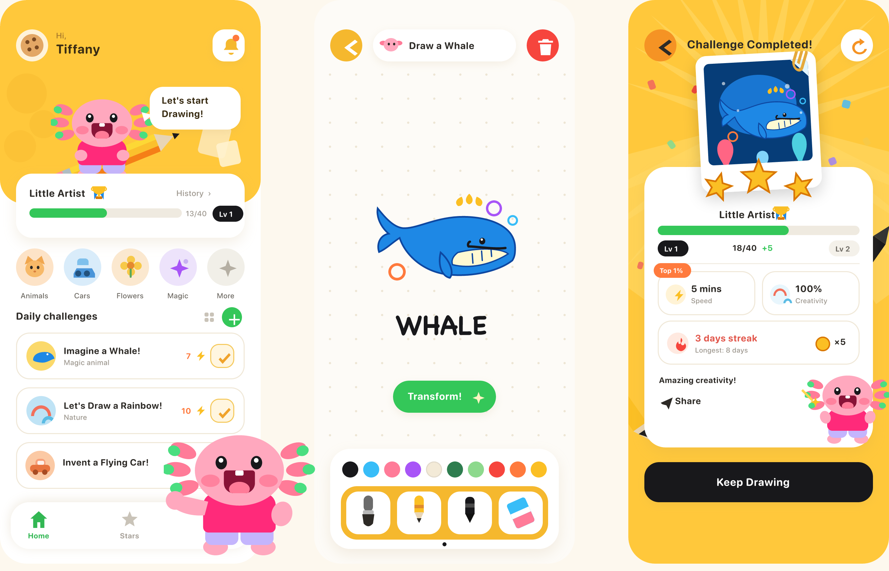
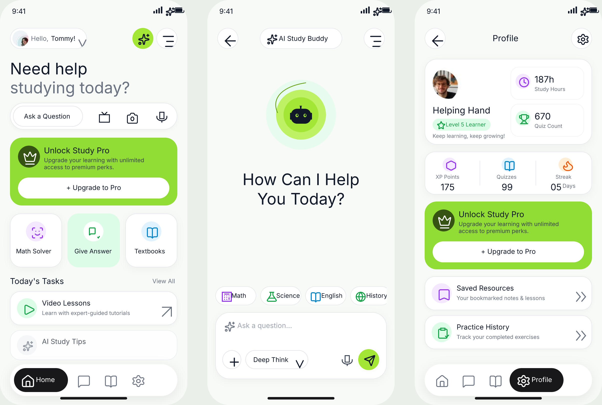
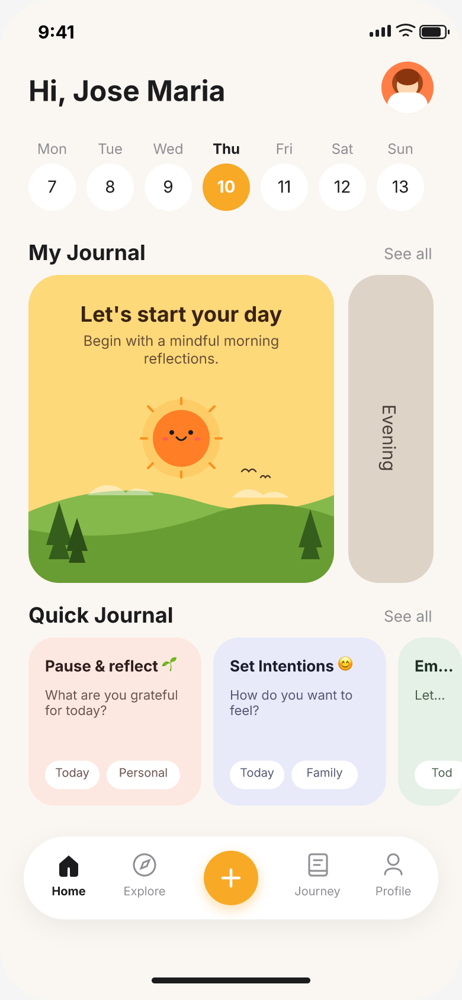

# 🎨 FigCraft MCP Skill Suite

[](LICENSE)
[](https://github.com/storytold/figcraft/releases/latest)
[](#-installing-the-skills)

A production-grade, battle-tested **Model Context Protocol (MCP) Skill Suite** that empowers AI coding assistants (Google Antigravity, Claude Code, Kiro, Cursor) to design, construct, prototype, and audit native **[FigCraft](https://github.com/storytold/figcraft)** interface files (`.figcraft`).

---

## 📸 Example Showcase

### 1. Kids Drawing App (3-Screen Flow + Mascot)
A multi-screen flow featuring Home screen with diagonal pencil hero, Draw screen with vector whale & color tools, and Challenge Completed screen with Polaroid artwork & 3D stars:

<p align="center">
  
</p>

*Native design file:* [`examples/kids-drawing-app.figcraft`](examples/kids-drawing-app.figcraft) · *Reproducible builder script:* [`examples/kids-drawing-app-build.py`](examples/kids-drawing-app-build.py)

### 2. AI Study Buddy (3-Screen Flow with Google Fonts & Iconify Icons)
A high-fidelity modern AI education mobile app featuring:
- **Google Fonts:** Real typography integration using `Plus Jakarta Sans` across all headings, cards, and labels.
- **Iconify Icons:** Authentic vector icons sourced directly from the `lucide` collection via the Iconify API.
- **Photo Avatars & Masking:** Real user avatars placed into rounded frames using native FigCraft `file.placeImage`.
- **3 Cohesive Screens:**
  1. **Home Screen:** Status bar, user profile pill, hero search bar, lime green "Unlock Study Pro" gradient card, quick tool cards (*Math Solver*, *Give Answer*, *Textbooks*), and today's tasks.
  2. **AI Study Buddy Screen:** Glowing multi-ring halo robot mascot, conversational headline, subject chips (*Math*, *Science*, *English*, *History*), and chat input with Deep Think toggle.
  3. **Profile Screen:** User level badge, statistics cards (187h study hours, 670 quiz count), 3-column metrics (XP, Quizzes, Streak), and interactive resource list.

<p align="center">
  
</p>

*Native design file:* [`examples/ai-study-buddy.figcraft`](examples/ai-study-buddy.figcraft) · *Reproducible builder script:* [`examples/ai-study-buddy-build.py`](examples/ai-study-buddy-build.py)

### 3. Mobile Home & Habit Tracker
An example mobile homescreen design reconstructed directly from a reference image using this skill suite via FigCraft MCP:

<p align="center">
  
</p>

*The native design file with 100+ vector and frame layers is available at [`examples/ui.figcraft`](examples/ui.figcraft).*

---

FigCraft is an open-source, high-performance, offline-first interface design tool written in Rust (a Figma-class desktop app). Its built-in MCP server (`figcraft-cli mcp`) allows AI agents to directly create nodes, manipulate vectors, and wire interactive prototypes.

However, raw MCP tools alone lack domain workflows and often lead to hallucinated behaviors. **This Skill Suite provides the expert operating procedures (SOP)**:
* **Anti-Overengineering (YAGNI):** Forbids unrequested screens and assumes nothing without user confirmation.
* **Figma-Standard Prototyping:** Proper `overflow: "horizontal"` content sliders and deliberate screen-to-screen transitions.
* **Engine Grounded & Anti-Hallucination:** Hardened against real FigCraft engine quirks (no false headless preview claims, safe `changeTo` wiring, and deterministic overflow verification).

---

## 🧩 The Modular Skills

```
skill-figcraft/
└── skills/
    ├── figcraft/              # 1. Master Coordinator (entry point, intake, device sizes)
    ├── figcraft-builder/      # 2. Native Screen & Component Construction
    ├── figcraft-svg/          # 3. Illustrations & Characters via authored SVG
    ├── figcraft-icons/        # 4. Interface Icons via the Iconify API
    ├── figcraft-typography/   # 5. Typeface Matching & Google Fonts install
    ├── figcraft-prototyper/   # 6. Sliders, Navigation, Overlays & State Wiring
    ├── figcraft-motion/       # 7. Transition & Animation Polish
    └── figcraft-review/       # 8. Design Scoring (100 Pts) & Pass/Fail Gates
```

Order matters: structure, then artwork, then motion. Transitions are never tuned on a flow that is not yet correct.

### 1. `figcraft` (Master Coordinator)
* **Path:** [`skills/figcraft/SKILL.md`](skills/figcraft/SKILL.md)
* **Role:** Single point of entry. Routes tasks sequentially: `builder` $\rightarrow$ `prototyper` $\rightarrow$ `review`.
* **Key Features:**
  * **Reference Manifest:** Maps multi-image inputs to screen frames, responsive sizes, and overlays before creating any layers.
  * **Real Device Sizes:** Screens come from the engine's own `frame.presets` catalog (phone, tablet, desktop, watch, presentation, paper) instead of remembered dimensions.
  * **Scope Gate:** Enforces strict intake rules for text-only prompts.
  * **Definition of Done:** Verifies structure, persistence, and hand-off before claiming completion.

### 2. `figcraft-builder` (Screen & Vector Builder)
* **Path:** [`skills/figcraft-builder/SKILL.md`](skills/figcraft-builder/SKILL.md)
* **Role:** Constructs production-ready design hierarchies from image references or specifications.
* **Key Features:**
  * **Hybrid Auto-Layout:** Auto-layout (`layout: "horizontal"` | `"vertical"`) for cards, lists, tags, and date strips; absolute positioning for status chrome, FABs, and decorative vectors.
  * **Strict Non-Presumptive Sizing:** Never forces arbitrary device sizes or fonts unless indicated by the source.
  * **Native Asset Handling:** Leverages `file.import` for SVGs/PNGs rather than wasting tokens redrawing existing assets.

### 3. `figcraft-svg` (Illustrations & Characters)
* **Path:** [`skills/figcraft-svg/SKILL.md`](skills/figcraft-svg/SKILL.md)
* **Role:** Authors curved artwork as SVG and imports it as editable native vectors, instead of stacking primitives to imitate illustration.
* **Key Features:**
  * **Named-by-Design Import:** An `id` on every SVG element becomes the FigCraft layer name, so imported art arrives semantically named.
  * **Hand-Drawn Looks:** Uses `stroke.widthProfile` and `stroke.brush` (taper, ink, ribbon, bristle, dots, stars, confetti, leaves) to reproduce marker and crayon references.
  * **Fidelity Loop:** Render, compare against the reference, re-import — and judge small artwork at its real display size.

### 4. `figcraft-icons` (Interface Icons)
* **Path:** [`skills/figcraft-icons/SKILL.md`](skills/figcraft-icons/SKILL.md)
* **Role:** Sources icons from published sets through the Iconify API rather than drawing inconsistent glyphs.
* **Key Features:**
  * **Search Before Import:** Guessed icon names return empty bodies that import as nothing, so the skill searches the API and validates the payload first.
  * **One Set Per Document:** Matches the reference's icon personality, then stays in that family; deliberate exceptions must be reported.
  * **Normalization:** Rename, recolor from `currentColor` black, unify stroke weight and size box, componentize repeats.

### 5. `figcraft-typography` (Type & Font Install)
* **Path:** [`skills/figcraft-typography/SKILL.md`](skills/figcraft-typography/SKILL.md)
* **Role:** Picks a typeface that matches the reference and gets it installed, without pretending a fallback is the real thing.
* **Key Features:**
  * **Google Fonts Store:** Uses `font.download` (Google Fonts and Noto, pinned and checksum-verified) and checks `font.downloads.allowed` first, because only the user can enable downloading.
  * **No Silent Fallback:** Verifies with `text.missingFonts` and surfaces `fontStyle` warnings when a requested face resolves to a different weight.
  * **Honest Identification:** Proposes candidates from observed letterforms instead of claiming to identify a typeface from an image.

### 6. `figcraft-prototyper` (Interactive Prototyping)
* **Path:** [`skills/figcraft-prototyper/SKILL.md`](skills/figcraft-prototyper/SKILL.md)
* **Role:** Wires living prototypes into static screens using Figma conventions.
* **Key Features:**
  * **Horizontal Content Sliders:** Bounded viewport + auto-layout track with `overflow: "horizontal"`.
  * **Deliberate Navigation Transitions:** Uses `proto.interaction.add` with `transition`, `durationMs`, and `easing` as interaction-level fields, choosing instant, dissolve, smart animate, move, push, or slide to match the design instead of defaulting to Smart Animate.
  * **Overlays & Modals:** Bottom-sheets with outside-click dismiss and dim backdrops (`openOverlay`), each with an explicit close path.
  * **Typing Boundary:** Transparently acknowledges runtime text input limits in FigCraft rather than falsely claiming arbitrary input typing.

### 7. `figcraft-motion` (Transition Polish)
* **Path:** [`skills/figcraft-motion/SKILL.md`](skills/figcraft-motion/SKILL.md)
* **Role:** The final pass. Tunes transitions, easings, springs, and delayed triggers once the flows already work.
* **Key Features:**
  * **Motion Model:** A duration and easing per interaction class — tab switch, forward push, sheet open, state morph, self-dismissing toast — instead of Smart Animate everywhere.
  * **Pairing Rules:** `smartAnimate` only pairs layers with the same name, depth, and type across frames, so second states are duplicated and edited rather than rebuilt.
  * **Restraint:** One primary motion per interaction, exits faster than entrances, nothing routine past ~400 ms.

### 8. `figcraft-review` (Quality & Accessibility Audit)
* **Path:** [`skills/figcraft-review/SKILL.md`](skills/figcraft-review/SKILL.md)
* **Role:** Automated audit for design tokens, auto-layout, and accessibility.
* **Key Features:**
  * **Design Quality Score (100 Points):**
    * Structure & Auto-Layout (40 pts)
    * Tokens & Visual Consistency (30 pts)
    * Accessibility & Usability (30 pts — validates touch targets $\ge 44\text{pt}$ Apple HIG / $24\times24\text{ CSS px}$ WCAG 2.2 AA).
  * **Separate Pass/Fail Gates:** Reference Coverage, Assets & Type & Size, and Prototype Correctness are judged outside the visual score (a broken navigation flow fails the prototype gate regardless of visual aesthetics).

---

## 🛠️ Prerequisites & Setup

### 1. Install `figcraft-cli`

The MCP server ships inside the `figcraft-cli` binary. Grab it from the official [FigCraft Releases](https://github.com/storytold/figcraft/releases/latest) (or build from source via Cargo).

**Always install the current release.** Pin nothing by hand — resolve the latest tag first:

```bash
# Resolve the newest published version
VERSION=$(curl -sL https://api.github.com/repos/storytold/figcraft/releases/latest \
  | sed -n 's/.*"tag_name": *"v\([^"]*\)".*/\1/p')
echo "Latest FigCraft: $VERSION"

# macOS (universal binary)
curl -L -o figcraft-cli.zip \
  "https://github.com/storytold/figcraft/releases/download/v${VERSION}/figcraft-cli-${VERSION}-macos-universal.zip"
unzip -o figcraft-cli.zip
mkdir -p ~/.local/bin
mv figcraft-cli-*-macos-universal/figcraft-cli ~/.local/bin/figcraft-cli
chmod +x ~/.local/bin/figcraft-cli
figcraft-cli --version
```

Release assets follow the pattern `figcraft-cli-<version>-macos-universal.zip`. Run `unzip -l figcraft-cli.zip` first if you want to confirm the folder layout before moving the binary. Linux and Windows builds are published in the same release as `figcraft-<version>-linux-*` and `figcraft-<version>-windows-*`.

### 2. (Optional) Install the desktop app for attached mode

Headless MCP needs only the CLI. The `figcraft-app` server below drives the **running desktop app**, which comes from a separate asset in the same release:

```bash
# macOS desktop app: figcraft-<version>-macos-universal.dmg
open "https://github.com/storytold/figcraft/releases/latest"
```

Then start it in control mode before connecting: `figcraft --control 7979`.

### 3. Configure MCP Server
Add FigCraft to your agent's MCP configuration (`mcp_config.json`, `~/.kiro/settings/mcp.json`, or Claude Desktop config):

```json
{
  "mcpServers": {
    "figcraft": {
      "command": "/absolute/path/to/figcraft-cli",
      "args": ["mcp"]
    },
    "figcraft-app": {
      "command": "/absolute/path/to/figcraft-cli",
      "args": ["mcp", "--attach", "7979"]
    }
  }
}
```

* **`figcraft` (Headless):** Starts an in-process headless session. Ideal for automated, high-speed background generation. Note that prototype playback is not observable in this mode — see the engine discoveries below.
* **`figcraft-app` (Attached):** Connects to your running desktop FigCraft app started with `figcraft --control 7979` so you can watch live canvas updates.

### 4. Keeping the engine current

```bash
figcraft-cli --version          # what you have
# compare against https://github.com/storytold/figcraft/releases/latest
```

Re-run the install block above to upgrade, then restart your agent so the MCP server reloads. The skills resolve command ids and parameter schemas through `list_commands` at runtime rather than hardcoding them, so a new engine release does not silently invalidate them. Two recent engine changes are worth knowing about when you upgrade:

* Commands, MCP tools, and batch steps now **reject parameter names they do not accept**, so a stray field fails loudly instead of being ignored.
* A failing step in a `batch` no longer necessarily rolls the whole batch back. Verify partial results with `inspect_document` after a batch error.

---

## 🚀 Installing the Skills

### Option A: Global Installation (Recommended)
Copy the skills to your global agent skills directory:

* **Antigravity / Gemini CLI:**
  ```bash
  cp -r skills/* ~/.gemini/config/skills/
  ```
* **Claude Code:**
  ```bash
  cp -r skills/* ~/.claude/skills/
  ```
* **Kiro IDE:**
  ```bash
  cp -r skills/* ~/.kiro/skills/
  ```

### Option B: Project-Level Installation
Copy the skills into your project's local agent folder (works for Cursor and any agent that reads project skills):
```bash
mkdir -p .agents/skills
cp -r skills/* .agents/skills/
```

---

## 🛡️ Battle-Tested Engine Discoveries

During rigorous empirical stress-testing against the live `figcraft-cli` binary, this skill suite uncovered and patched several critical edge-case behaviors:

1. **Write-Only `overflow` Property:**
   FigCraft saves `"overflow": "horizontal"` into `.figcraft` correctly, but `inspect_document`, `get_node`, `inspect.properties`, and `inspect.code` do not return this field. This suite teaches the AI to verify sliders through three deterministic methods (call status, track vs. viewport bounding boxes, and `.figcraft` zip inspection) rather than hallucinating.
2. **Headless `proto.preview` Reality:**
   In headless mode, `proto.preview` returns success without a window and cannot simulate interactive click-throughs. The suite prohibits false "runtime verified" claims and generates explicit manual verification checklists for the human designer.
3. **`changeTo` Variant Validation:**
   The FigCraft engine accepts `changeTo` interactions pointing to regular frames without throwing an error, but the wire fails silently during playback. The suite enforces pre-wiring checks ensuring the destination is an authentic component variant.
4. **Uneven Parameter Validation:**
   The engine does reject an invalid `overflow` value, an invalid overlay `position`, and a `dest` id that does not exist — the error text even names the accepted values. It does not check semantic correctness such as an overlay without a close path or a scroll track smaller than its viewport. The suite assigns those checks to the agent.
5. **SVG Import Carries Names, Not Fonts:**
   An `id` attribute on an SVG element becomes the FigCraft layer name, gradients and strokes survive, and `<circle>` arrives as a real ellipse — but the SVG `font-family` is dropped and `currentColor` resolves to solid black. The suite therefore puts ids on every shape, keeps copy out of the SVG, and recolors after import.
6. **Font Downloading Is User-Gated:**
   `font.download` pulls pinned, checksum-verified families from Google Fonts and Noto, but it is refused unless the user enables downloading in Text ▸ Missing fonts. A stock install reports `{"allowed": false}`. The suite checks `font.downloads` first and asks instead of retrying.
7. **Guessed Icon Names Import as Nothing:**
   A plausible-looking Iconify identifier that does not exist returns an empty body (9 bytes in testing), which imports as an empty frame rather than an error. The suite searches the Iconify API and validates the payload before importing.

---

## 🤝 Contributors & Community

* **Fauzi Ferdiansyah** ([@FauziFerdiansyah](https://github.com/FauziFerdiansyah)) — Creator, Architect & Maintainer
* **Akhmad Sugiannoor** — Early MCP bridge inspiration
* **GPT-5.6-sol** — Architectural decomposition & Master Coordinator design
* **Claude** — Empirical stress-testing, engine grounding & anti-hallucination hardening
* **[storytold/figcraft](https://github.com/storytold/figcraft)** — The open-source Rust design engine

See [CONTRIBUTORS.md](CONTRIBUTORS.md) for detailed acknowledgments.

---

## 📄 License

This project is licensed under the [MIT License](LICENSE).
